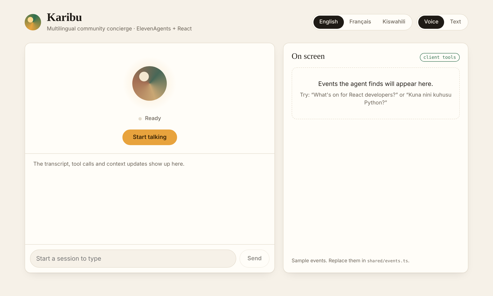
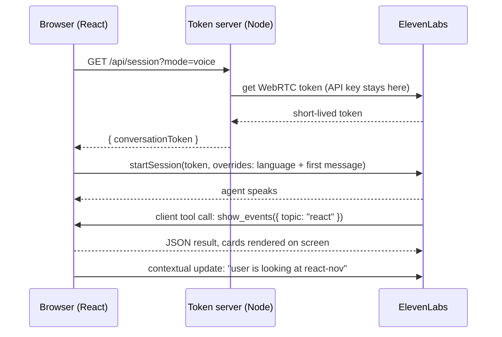

# Karibu

**A multilingual voice and text agent built with [ElevenAgents](https://elevenlabs.io/docs/eleven-agents) and React.** It speaks English, French and Swahili, calls tools that run in your browser, and never exposes your API key.

*Karibu* means "welcome" in Swahili. The demo is a concierge for the developer community in Kigali, Rwanda: ask what's coming up, and the agent shows event cards on screen and saves your spot. The patterns are general, so you can swap the events for your own data and keep the rest.



## What this shows

| Pattern | Where |
| --- | --- |
| **Private agent + server-issued credentials.** WebRTC tokens for voice and signed URLs for text, minted by a small Node server, so the browser never sees the API key. | [`server/app.ts`](server/app.ts) |
| **Agent as code.** One script creates or updates the agent, its tools, its languages and its security settings from a typed definition. Re-running it is safe. | [`scripts/sync-agent.ts`](scripts/sync-agent.ts), [`shared/agent.ts`](shared/agent.ts) |
| **Client tools.** The agent calls `show_events` and `register_interest`, which run in React and update the UI. The handlers validate LLM input and return results written for the model. | [`src/App.tsx`](src/App.tsx), [`shared/tools.ts`](shared/tools.ts) |
| **Contextual updates.** Clicking an event card tells the agent what the user is looking at, without forcing a reply. | `focusEvent` in [`src/App.tsx`](src/App.tsx) |
| **Three languages, one agent.** Language and first message are client overrides, and the agent can switch mid-conversation with the `language_detection` system tool. | [`shared/agent.ts`](shared/agent.ts) |
| **Voice and text in the same UI.** Text mode skips the microphone and the audio stack entirely. | `start()` in [`src/App.tsx`](src/App.tsx) |

## Quickstart

You need Node.js 20.19+, [Yarn 1](https://classic.yarnpkg.com/) and an [ElevenLabs API key](https://elevenlabs.io/app/settings/api-keys) with ElevenAgents read and write access.

```bash
git clone https://github.com/<you>/karibu.git && cd karibu
yarn
cp .env.example .env          # then paste your key into ELEVENLABS_API_KEY
yarn agent:sync            # creates the agent and its tools, saves the id to .env
yarn dev                   # http://localhost:5173
```

Pick a language, choose **Voice** or **Text**, press **Start**, and ask *"What's on for React developers?"*, *"Il y a quoi pour les développeurs Python ?"* or *"Kuna matukio gani ya open source?"*.

## How it works



### 1. Credentials stay on the server

The agent is created with `auth.enableAuth: true`, so nobody can start a conversation with only its id. The browser asks our server for a session:

- **Voice** gets a **WebRTC conversation token**, the lowest-latency transport.
- **Text** gets a **signed WebSocket URL**, the default for text-only sessions.

`server/app.ts` adds the things a public demo needs: `Cache-Control: no-store`, a per-client rate limit so nobody can drain your credits, and error messages that never echo upstream details. The app takes the credential provider as a parameter, so tests use a fake one.

### 2. The agent is defined in code

`shared/agent.ts` holds the system prompt, the languages with their first messages, and the client tool schemas. `yarn agent:sync` then:

1. Creates each client tool through the Tools API, or updates it if one with that name exists, with `expectsResponse: true` so the agent waits for the browser's answer.
2. Creates the agent (or updates it when `ELEVENLABS_AGENT_ID` is set) with those tool ids, the `end_call` and `language_detection` system tools, and French and Swahili language presets.
3. Allows the browser to override **only** the language, the first message and text-only mode.

The React app imports the same file, so the tool names and languages can't drift apart.

> **Why `eleven_v3_conversational`?** Swahili is only covered by Eleven v3 among the TTS models available to agents ([language support](https://elevenlabs.io/docs/help-center/other/what-languages-do-you-support)). If you only need English and French, Flash v2.5 gives lower latency.

### 3. Client tools

```tsx
useConversationClientTool("show_events", (params) => {
  const topic = typeof params.topic === "string" ? params.topic : undefined;
  const matches = findEvents(EVENTS, topic);
  setShown(matches);                       // update the UI
  return eventsToolResult(matches, topic); // tell the agent what happened
});
```

Three rules the handlers follow:

- **Parameters are untrusted.** They come from an LLM, so they're type-checked before use, and an invented event id is rejected.
- **Results are written for the model.** Empty results say so explicitly ("No upcoming events match… suggest another topic") so the agent doesn't fill the gap with made-up events.
- **The logic is pure.** It lives in `shared/tools.ts` with no React or SDK imports, so it's unit-tested.

Every tool call and contextual update is shown in the transcript, which makes the agent's behaviour easy to debug.

## Project structure

```
shared/          agent definition, sample events, tool logic (used by both sides)
server/          Hono token server; serves the built app in production
scripts/         sync-agent.ts: agent and tools as code
src/             React app (ConversationProvider, client tools, UI)
tests/           Vitest tests for the server and the tool logic
```

## Scripts

| Command | What it does |
| --- | --- |
| `yarn dev` | Token server and Vite with hot reload. Vite proxies `/api` to the server. |
| `yarn agent:sync` | Create or update the agent and its tools from `shared/agent.ts`. |
| `yarn test` | Unit tests. |
| `yarn verify` | Typecheck, tests and production build, the same as CI. |
| `yarn build && yarn start` | Production: one Node process serves the app and the API. |

## Make it yours

- **Your own data:** replace `getEvents()` in `shared/events.ts` with your source (a JSON file, a CMS, the Luma API…).
- **A new tool:** add it to `CLIENT_TOOLS` in `shared/agent.ts`, handle it with `useConversationClientTool`, then run `yarn agent:sync`.
- **Another language:** add an entry to `LANGUAGES` and run `yarn agent:sync`. Check that your TTS model supports it.
- **Production:** put the server behind your own auth (a logged-in user should be required before minting tokens), use a shared rate limiter such as Redis, and add your domain to the agent's allowlist in the ElevenLabs dashboard.

## Troubleshooting

| Symptom | Fix |
| --- | --- |
| `ELEVENLABS_AGENT_ID is not set` | Run `yarn agent:sync`. |
| `The API key you used is missing the permission convai_read` | The key needs **ElevenAgents: Write**. Edit the key's permissions in the ElevenLabs dashboard, and check that the key in `.env` is the one you edited (compare the last 4 characters). |
| `Could not start a session with ElevenLabs` | Check the server logs. Usually the API key is wrong or missing the ElevenAgents permission. |
| Microphone blocked | Allow it in the browser, or switch to **Text** mode. On a remote host the page must be served over HTTPS. |
| Agent says it did something but the UI didn't change | The tool name in `shared/agent.ts` and in `useConversationClientTool` must match. Re-run `yarn agent:sync`. |

## License

MIT
